# Good Customers by SLIK Score: Approval vs Score, Age, KOL and Credit Limit

**Role:** Data Analyst. Ran the analysis end to end: queries, charts and write-up.  
**Goal:** Test whether a customer's SLIK credit score, age and credit capacity explain which applications banks approve, and how much they are willing to lend.  
**Tools:** Python-style scatter plots and histograms and spreadsheet pivot tables (judging by the screenshots; the Notion page does not name the tools)  
**Period:** Oct 2025  
**Related:** [02 Good-customer characteristics across channels](../02-good-customer-characteristics/good-customer-characteristics.md) covers the channel-level comparison of scores (Ciputra, Skorlife, D2C, Julo). This page uses the combined transaction data and goes deeper on approval.  

<!-- CHECK: the Notion page is titled "Akad based on age vs score range...", but the pivot tables are labelled "approval_percentage". I describe them as approval; change to akad if the numerator is signed contracts. -->

## Terms

- **SLIK score range:** the credit bureau's score bands, labelled `Ji` (best) down to `Bi`. I also used three simpler numeric bands: **above 500**, **400 to 500** and **100 to 400**.
- **KOL (kolektibilitas):** the SLIK payment-quality rating, from 1 (best) to 5 (worst).
- **Plafond:** the loan amount a bank approved. **Credit limit:** the customer's total credit limit across all their existing facilities in SLIK.
- Amounts of "Rp 1 M" on the charts are Rp 1 **miliar** (billion), not million. I write "billion" below.

The pivot tables show percentages that add up to about 80% to 85% per row, not 100%. The remainder is not shown. My reading is that it is applications without a score or KOL (many customers have no score at all, see [01](../01-ovo-customer-analysis/ovo-customer-analysis.md)), but the page does not say.

---

## 1. Do older customers need a very high score to be approved?

**Hypothesis:** older applicants need a very high credit score to be approved, and the reverse holds for younger ones.

I cut approved applications by age group and score range. The first table uses the nine score bands:

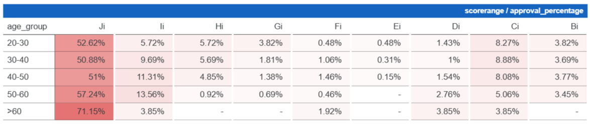

The second collapses them into three numeric bands:

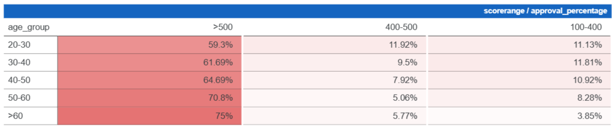

| Age group | Score above 500 | 400 to 500 | 100 to 400 | 100 to 500 combined |
|---|---|---|---|---|
| 20-30 | 59.30% | 11.92% | 11.13% | 23.05% |
| 30-40 | 61.69% | 9.50% | 11.81% | 21.31% |
| 40-50 | 64.69% | 7.92% | 10.92% | 18.84% |
| 50-60 | 70.80% | 5.06% | 8.28% | 13.34% |
| over 60 | 75.00% | 5.77% | 3.85% | 9.62% |

What the tables show:

- **The share of approvals that come from the top band `Ji` rises with age:** 52.6%, 50.9%, 51.0%, 57.2% and 71.2% from the youngest to the oldest group. The over-60 group is small (the percentages move in steps of about 1.9%, which implies roughly 52 approvals), so its 71% is the least reliable number.
- **Low and mid scores (100 to 500) account for a shrinking share of approvals as age rises**, from 23% for ages 20 to 30 to 13% for 50 to 60. In other words, younger applicants with weak scores still get approved, and older ones mostly don't.
- **Most approved applications are in the top band at every age.** Even among 20 to 30 year olds, about 59% of approvals score above 500.

**Conclusion:** the hypothesis is directionally right, but not strongly. Older approved customers lean more heavily on high scores, but a high score matters at every age.

<!-- CHECK: the Notion note says "Ji" is the "very-very good" band, but I could not confirm the numeric cut-offs of Ji..Bi. A separate Notion page ("Slik Score range issue", Nov 2026) reports that some scores (e.g. 533, 568) were mapped to bands below Ji in the data even though the SLIK documentation puts them in Ji. If that mapping also affected this analysis, the nine-band table (but not the numeric three-band table) is affected. -->

---

## 2. Does a higher credit limit mean a higher approved plafond?

Each dot is one approved application, plotted by the customer's total credit limit against the plafond the bank approved. The red line is a linear fit with a confidence band. The first chart is clipped at Rp 7 billion; the next two zoom into the dense area.

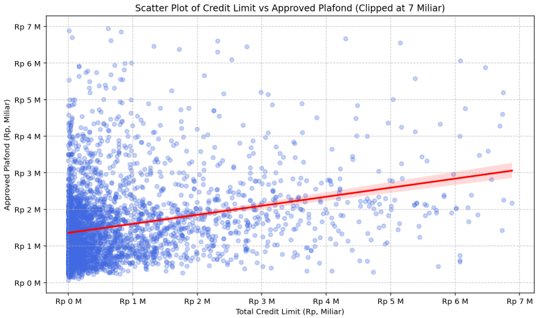

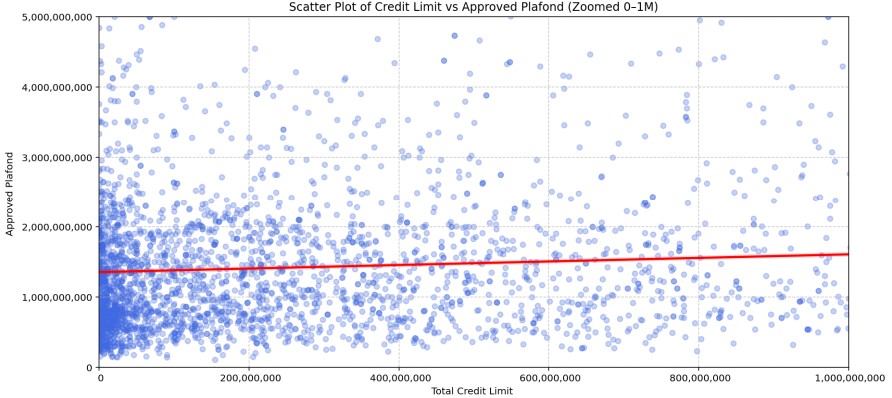
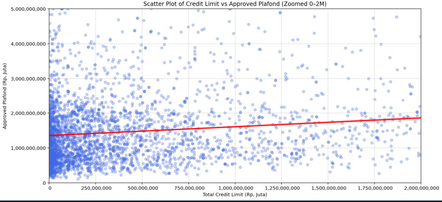

*(Left: credit limit up to Rp 1 billion. Right: up to Rp 2 billion.)*

- **Overall, there is a positive trend.** Reading the fitted line, approved plafond rises from about Rp 1.35 billion at a credit limit of zero to about Rp 3.05 billion at a limit of Rp 6.9 billion.
- **Most customers have a credit limit under Rp 1 billion.** Most of the dots sit in the lower-left corner, in the dense band of approved plafonds between Rp 0.3 and 2 billion.
- **The spread is huge.** At any given credit limit, approved plafonds range from under Rp 0.5 billion to over Rp 4 billion. The credit limit explains only a small part of how much a bank lends.
- **Notion's reading:** the relationship is positive overall, but below a limit of Rp 1 billion the line looks flat and the dots are scattered. It was only when the view widened to Rp 2 billion that the line looked clearly positive. The author could not find what else drives plafond for lower-limit customers.

**My reading of the lines (not in the Notion page):** the fitted line has a similar slope in all three charts, about Rp 0.25 of extra plafond for each extra Rp 1 of credit limit (for example, Rp 1.35 billion to about Rp 1.6 billion across the first Rp 1 billion). So the "flat" impression in the zoomed chart is partly a result of the axis scale, not a different relationship. What is clear is that the line starts high, at about Rp 1.35 billion, even for customers with almost no existing credit limit. That fits plafond being driven mostly by something other than existing credit, such as the size of the property loan being requested. That is a hypothesis, not tested here.

<!-- CHECK: the Notion text says "credit score >1M" and "credit limit vs plafond is only true for >1M". The charts plot credit limit, not score, so I read this as credit limit above Rp 1 billion. -->

---

## 3. Payment history (KOL) and score

### KOL against score range

Among approved applications, the share that have a top-band score, by worst KOL:

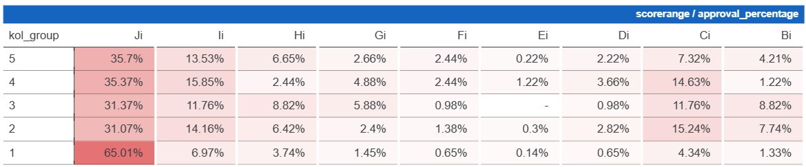

| KOL | Share in top band `Ji` |
|---|---|
| 1 (best) | 65.0% |
| 2 | 31.1% |
| 3 | 31.4% |
| 4 | 35.4% |
| 5 (worst) | 35.7% |

- **KOL 1 is clearly different:** about two thirds of KOL 1 approvals score in `Ji`.
- **KOL 2 to 5 look almost the same:** a worse payment history (KOL 5) does not mean a lower score band among approved applications. About 35% of the KOL 5 approvals are still in the top band.
- **KOL 3 and 4 are small groups** (roughly 100 and 80 approvals, judging by the percentage steps), so their numbers move around more.

Notion adds a related view of all transactions, plotting raw score against credit limit (clipped at Rp 5 billion):

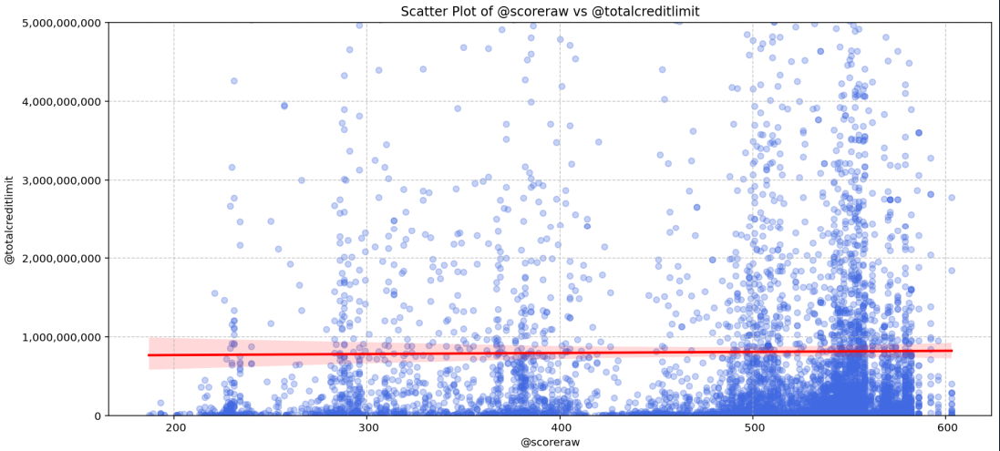

The fitted line is essentially flat (about Rp 0.77 billion to Rp 0.82 billion across scores of 190 to 600). **A customer's score says almost nothing about the size of their credit limit.** There is a visible cluster of dots at scores of 500 to 580, which is simply where most customers' scores fall.

### KOL against age

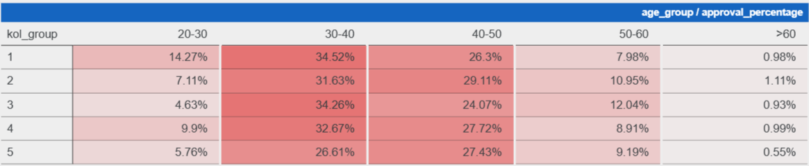
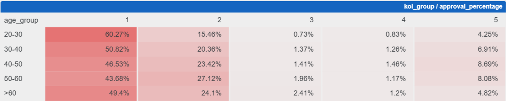

*(Left: age group split within each KOL. Right: KOL split within each age group.)*

- **Approvals are concentrated at ages 30 to 50** for every KOL.
- **Younger approved customers are more often KOL 1:** 60.3% of approvals aged 20 to 30 are KOL 1, against 50.8%, 46.5% and 43.7% for the next three age groups (49.4% for over 60).
- **The share at KOL 2 grows with age,** from 15.5% (20 to 30) to 27.1% (50 to 60). The share at KOL 5 is highest at ages 40 to 50 (8.7%).
- Together, KOL 1 and 2 are about 70% to 76% of approvals in every age group, so the payment-quality mix does not change as much with age as the KOL 1 share alone suggests.

---

## 4. Score vs credit limit, by age group

For each age group I plotted raw score against total credit limit. The vertical scale differs between charts.

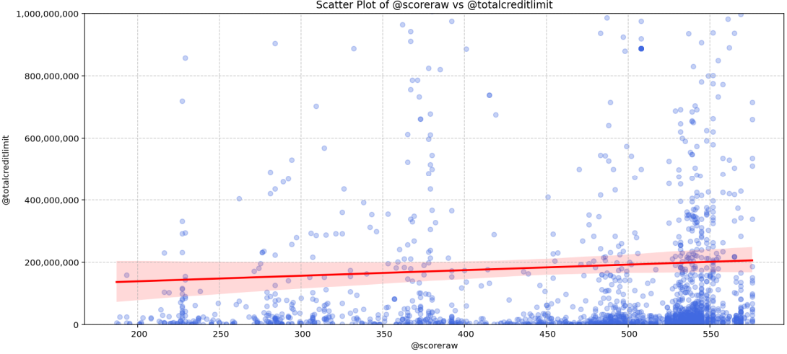
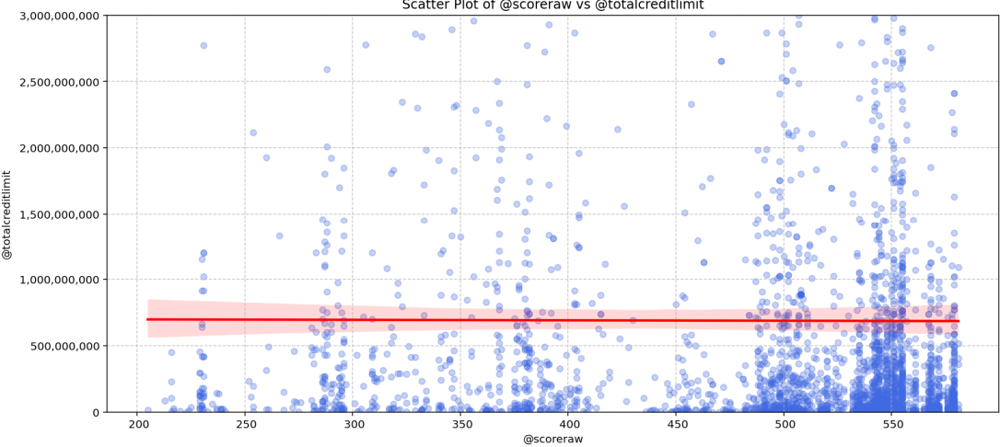

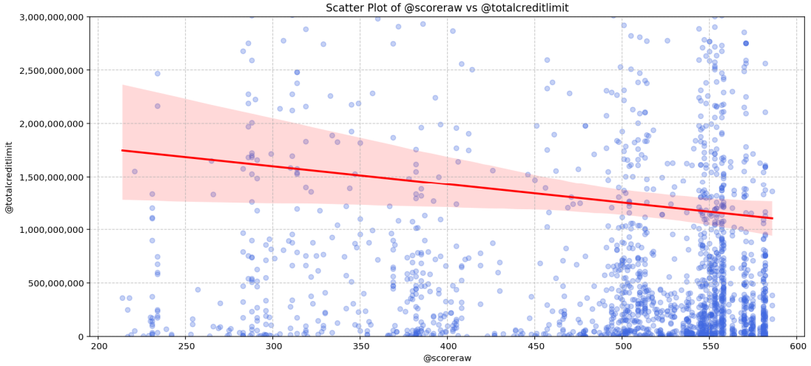
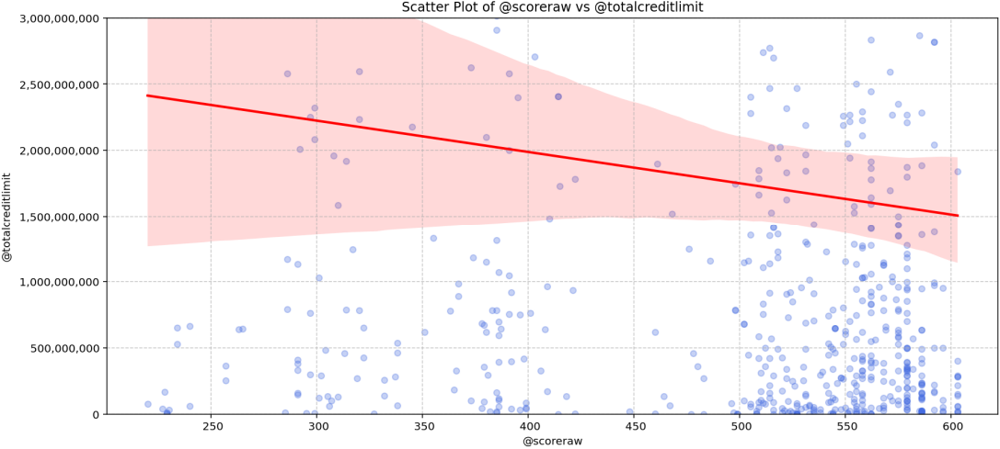

*(Top left to bottom right: ages 20-30 (clipped at Rp 1 billion), 30-40, 40-50 and 50-60 (all clipped at Rp 3 billion).)*

| Age group | Fitted line, low score to high score |
|---|---|
| 20-30 | Slightly up (about Rp 0.14 billion to Rp 0.21 billion) |
| 30-40 | Flat (about Rp 0.7 billion) |
| 40-50 | **Down** (about Rp 1.75 billion to Rp 1.1 billion) |
| 50-60 | **Down**, with a very wide band (about Rp 2.4 billion to Rp 1.5 billion) |

For older customers, **those with the largest credit limits tend to have lower scores**, the opposite of what a "wealthier means better credit" assumption would give. The Notion page does not comment on this. One possible reading, which I did not test, is that very large existing exposure drags down the score. The 50 to 60 band is wide because there are few points, so I would not lean on it.

---

## 5. Does where a customer lives, or their phone, change their score?

For transactions that have Amplitude data, I compared raw score by region (Jabodetabek vs elsewhere) and by device (Apple vs non-Apple). Only **430 of 6,853** such transactions came from the LOS (loan origination system) and **6,423** from the consumer app, so this view is almost entirely consumer-app customers.

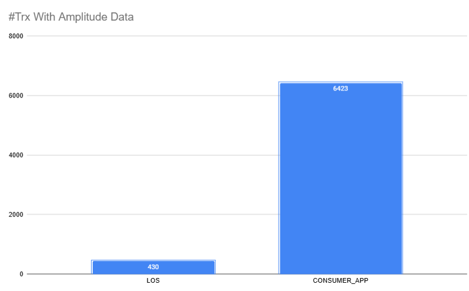

| Group | N | Mean | Median | Q1 | Q3 |
|---|---|---|---|---|---|
| Jabodetabek | 944 | 465.8 | 508 | 382 | 543 |
| Non-Jabodetabek | 1,678 | 456.9 | 502 | 373 | 539 |
| Apple users | 366 | 467.4 | 513 | 383 | 542 |
| Non-Apple users | 2,329 | 456.3 | 501 | 375 | 541 |
| Apple, Jabodetabek | 182 | 470.9 | 513 | 406 | 542 |
| Apple, non-Jabodetabek | 136 | 460.4 | 504 | 382 | 537 |

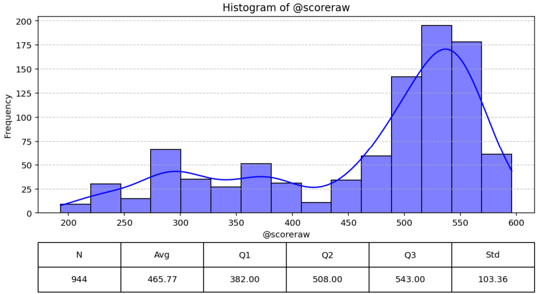
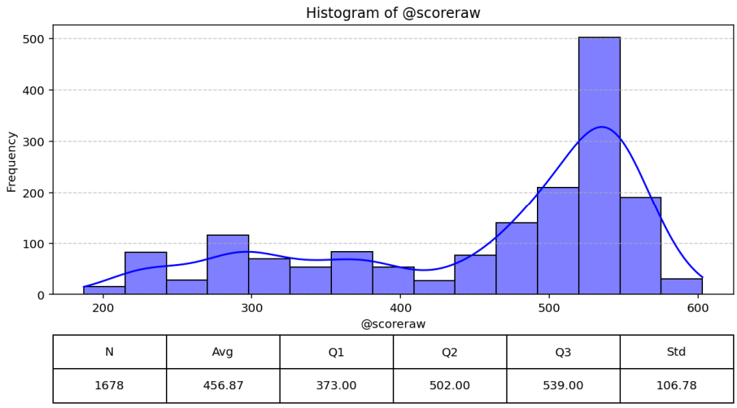

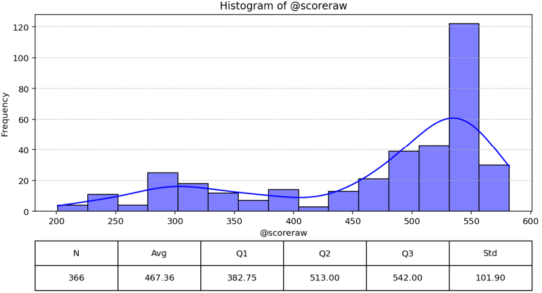
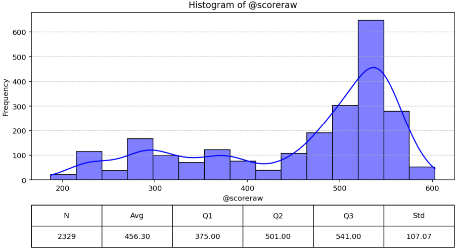

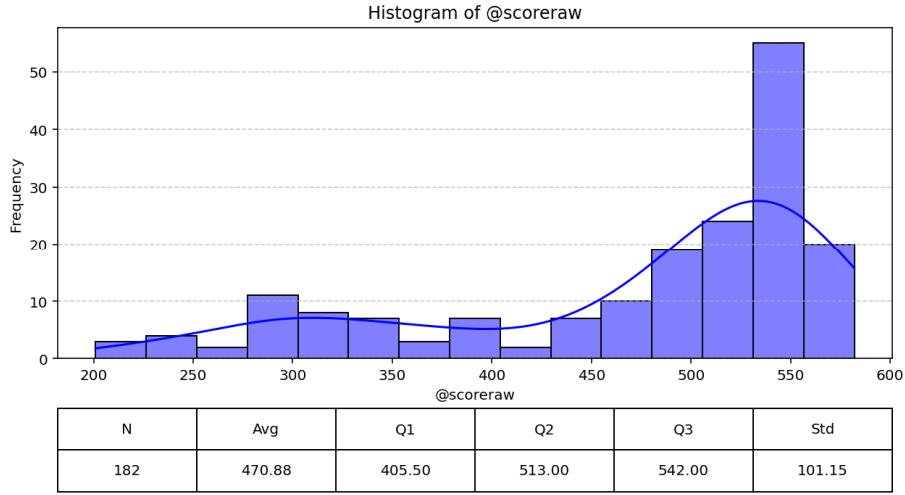
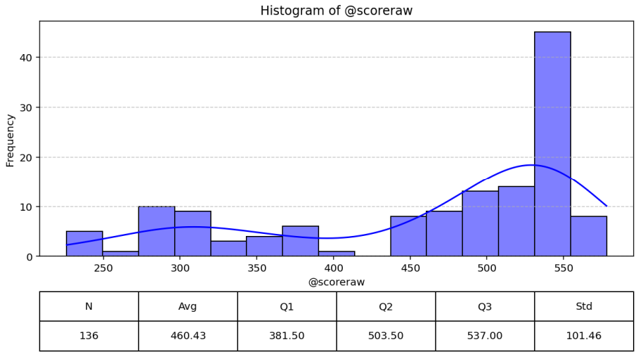

*(Score histograms in the order of the table: Jabodetabek and non-Jabodetabek, Apple and non-Apple, Apple Jabodetabek and Apple non-Jabodetabek.)*

- **The differences are small:** the median is about 7 to 12 points higher for Jabodetabek and for Apple users, against a spread of about 100 points. Jabodetabek and Apple users are slightly better, but neither separates good scores from bad ones.
- **Every group has the same two-humped shape:** a main cluster around 500 to 560 and a thinner tail from about 200 to 400.

**Credit limit by region.** Jabodetabek customers have a higher median credit limit (Rp 18.9 million, N=145) than non-Jabodetabek customers (Rp 11.7 million, N=306), though the averages are similar (about Rp 57 to 60 million).

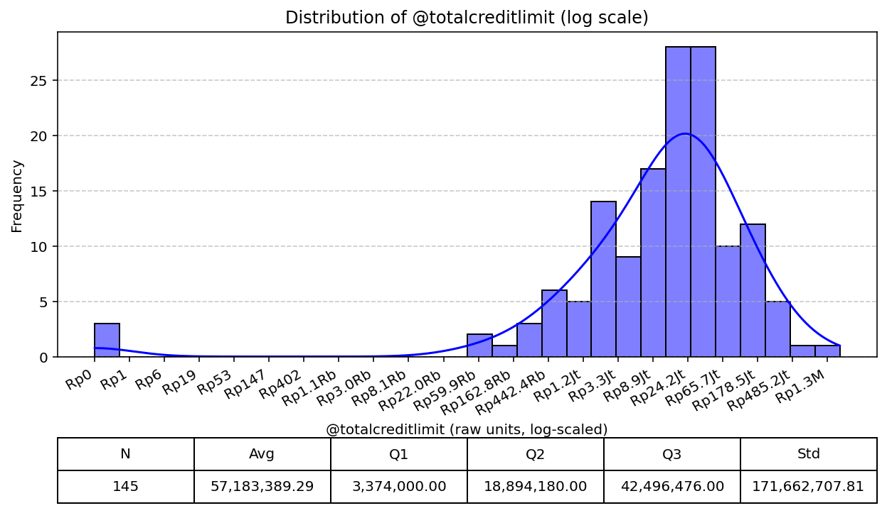
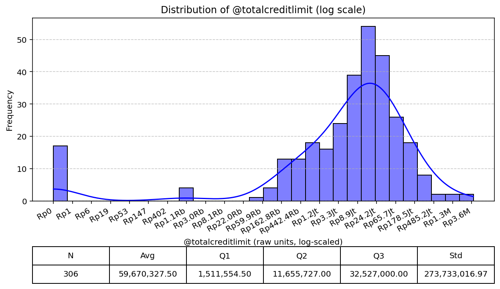

<!-- CHECK: the Notion page does not label which chart is which. I assigned them by the order of the captions (first-named group on the left). For Apple vs non-Apple this is supported by the sample sizes (366 vs 2,329), but for Jabodetabek vs non-Jabodetabek and for the credit-limit pair it is only an assumption. Also the credit-limit charts have much smaller N (145, 306) than the score charts; the page does not say why. -->

---

## What I took away

- **A good score matters, but it is not a gate.** Most approved applications score above 500 at every age, yet a fifth to a quarter of approvals for the under-40s come from the 100 to 500 range.
- **Age shifts how much weight the score carries:** older approved customers lean more on high scores.
- **Existing credit limit is a weak guide to how much a bank will lend.** The plafond is large even at near-zero limit, and the trend explains little of the spread.
- **Payment history separates KOL 1 from everyone else,** but KOL 2 to 5 look alike on score.
- **Location and device barely move the score,** so they are poor shortcuts for finding good customers.
- **Many of these tables are shares of approvals, not approval rates.** They describe who gets approved, not who is likely to be approved, so they say nothing on their own about conversion. Linking them to the full applicant pool, as in [02](../02-good-customer-characteristics/good-customer-characteristics.md), is the next step.

